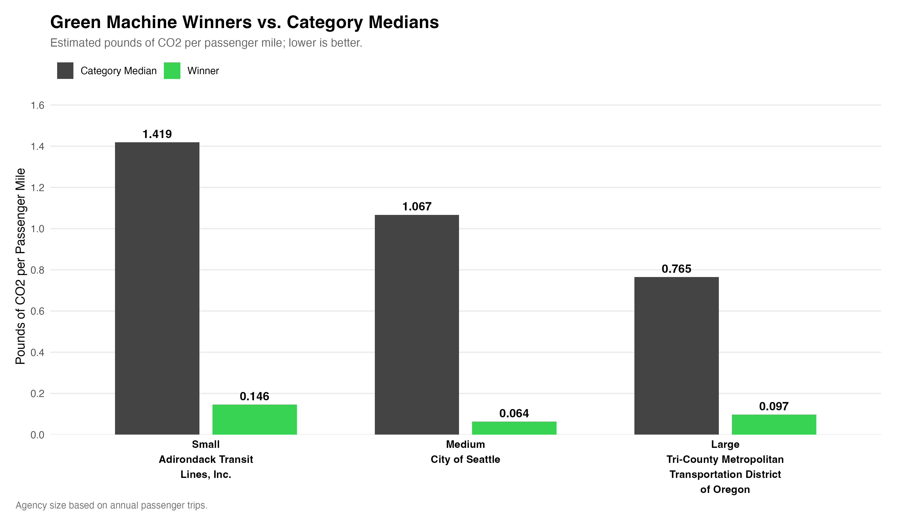
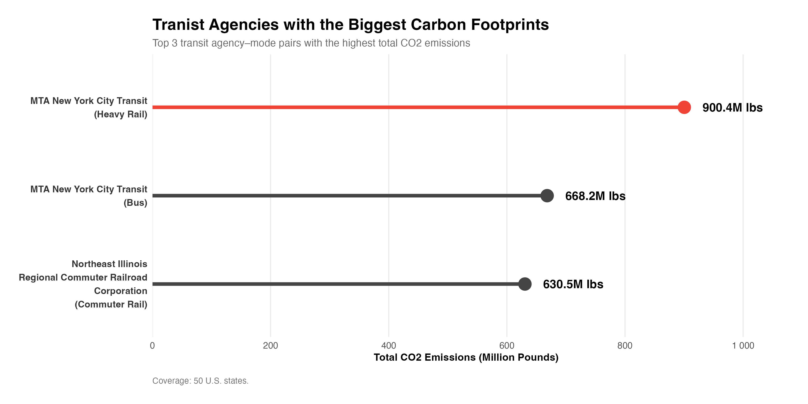

# Press Release: The 2026 Transit Awards

**FOR IMMEDIATE RELEASE**

**NEW YORK, November 2026** — Roll out the green carpet (or black for some)! After crunching the numbers, counting passenger miles, and calculating more carbon emissions than anyone reasonably wants to think about, the results are finally in.

Welcome to the 2026 Transit Awards, where we celebrate the transit agencies keeping their carbon footprints tiny and gently roast those whose footprints look more like dinosaur tracks.

In the words of Naaz Parvaz, Director of Transportation Sustainability Research, “Some transit agencies are going green while others are leaving footprints big enough to see from space.”

*And the winners are...*

## **The Green Machine Awards**

The Green Machine Awards recognize the transit agencies producing the lowest estimated CO₂ per passenger mile in their respective ridership categories - Small, Medium and Large.

### *Category: Small*  
**Winner: Adirondack Transit Lines, New York**

Adirondack Transit Lines takes home the Small Agency Green Machine Award, recording just **0.146 lbs of CO₂ per passenger mile**, compared with a small-agency median of 1.419 pounds. That is **nearly 90% less** than its typical small-agency competitors.

*A true masterclass in keeping a low profile and even lower carbon emissions.*

### *Category: Medium*  
**Winner: City of Seattle, Washington**

With emissions of just **0.064 lbs per passenger mile**, compared with a medium-agency median of 1.067 lbs which is **94% less** than other agencies in the category, Seattle takes the crown for the largest percentage improvement over its category benchmark among the Green Machine winners.

*Apparently, the secret ingredient in Seattle's coffee is carbon efficiency.*

### *Category: Large*  
**Winner: TriMet, Oregon**

With approximately 65.7 million annual passenger trips, TriMet proves that being a big transit agency doesn't automatically mean having a big carbon footprint per passenger mile.

Its estimated emissions intensity of **0.097 pounds per passenger mile** is **approximately 87% below** the large-agency median of 0.765 lbs.

*Big enough to move millions. Green enough to barely leave a mark.*

{#fig-green-machine width="100%"}

## **The Carbon Stomp Awards**

Now for the awards nobody asked to win.

While the Green Machines were busy shrinking their footprints, these transit operations were (carbon) stomping their way to leave a mark, quite literally!

The Carbon Stomp Awards recognize the three agency-mode combinations with the highest total estimated CO₂ emissions, calculated by adding the estimated emissions reported for each agency's individual transit mode. Unlike the Green Machine Awards, these rankings measure total emissions, not emissions efficiency.

### *1st Place*
**MTA New York City Transit - Heavy Rail**

New York City, really knows how to make an entrance.

The subway takes first place with approximately **900.4 million lbs** of estimated CO₂.
That is roughly **1.35 times** the emissions of the second-place winner, MTA's bus operations, at 668.2 million pounds.

*Between the rats, the delays, and the occasional mystery puddle, New Yorkers already have enough to deal with. Now their subway has an award-winning carbon footprint, too.*


### *2nd Place*
**MTA New York City Transit - Bus**

Not satisfied with first place, New York City Transit decided to take second place, too. 

Its bus operations generated approximately **668.2 million lbs** of estimated CO₂, about **6% more** than the third-place winner, at 630.5 Million lbs.

Together, the MTA's heavy rail and bus operations generated approximately **1.57 Billion lbs** of CO₂.

*The city that never sleeps. Apparently, neither do its emissions.*

### *3rd Place*
**Northeast Illinois Regional Commuter Railroad Corporation - Commuter Rail**

Coming in third is the Chicago region's commuter rail operator, with approximately **630.5 million lbs** of estimated CO₂.

That's about 70% of the first-place winner's emissions. Not quite enough to take the crown, but certainly enough to earn a bronze.

*Chicago is known for deep-dish pizza, strong winds, and now a commuter rail carbon footprint!*

{#fig-green-machine width="100%"}

## Understanding the Results: Bigger Footprint Doesn't Always Mean Worse Transit

Before anyone starts sending angry emails to the MTA, there's one important detail.

*The Green Machine Awards measure efficiency. The Carbon Stomp Awards measure total emissions.*

Big transit systems transport millions of passengers, so they can produce more emissions overall even while offering relatively efficient transportation.

In other words, winning a Carbon Stomp Award doesn't automatically make an agency environmentally worse than its competitors.

We are celebrating the numbers, not canceling the subway. Please, New Yorkers have places to be and they can’t afford the MTA to get delayed because they were busy responding to your angry emails. 

## And That's a Wrap!

From Adirondack's lightweight footprint to the MTA's double appearance on the carbon podium, this year's awards prove one thing: When it comes to transit sustainability, it's not just about how far you go, but how efficiently you get there.

*Here's to greener journeys, cleaner energy, and hopefully fewer carbon stomps next year. Until then, tread lightly and mind your emissions!*

## Research Methodology

**Sources:** National Transit Database (NTD) energy consumption and service data; U.S. Energy Information Administration (EIA) emissions factors.

The research combined three publicly available datasets:  

1. **NTD Energy Data:** Reported fuel and electricity consumption by transit agency and mode.  
2. **NTD Service Data:** Passenger trips, passenger miles, agency information, and transit service characteristics.  
3. **EIA Data:** State-level electricity emissions factors, supplemented by EIA fuel emissions conversion factors.  

Reported fuel and electricity consumption were converted into estimated pounds of CO₂ using applicable emissions factors.

**Calculation Summary:**  

- **Green Machine Awards:**  For the Green Machine Awards, emissions were aggregated at the agency level and divided by total passenger miles. Agencies were grouped by annual unlinked passenger trips into Small (100,000–999,999), Medium (1 million–9,999,999), and Large (10 million or more) categories. The lowest-emitting agency per passenger mile in each category was selected and compared with its category median.

- **Carbon Stomp Awards:** For the Carbon Stomp Awards, total estimated emissions were aggregated by agency and transit mode. The three highest totals were selected, regardless of agency size. Comparisons with other podium winners provide context; these are not comparisons with the median transit operation. 

**Coverage and limitations:** The analysis covers the 50 U.S. states. Results depend on the completeness and accuracy of reported energy data and do not measure life-cycle emissions. Total emissions should not be interpreted as a direct measure of transit efficiency.

## About Transit Sustainability Research Institute (TSRI)

The Transit Sustainability Research Institute (TSRI) is an independent research organization dedicated to making public transportation cleaner, smarter, and more sustainable. Through data-driven research and environmental performance analysis, TSRI evaluates transit systems across the United States, highlighting both sustainability champions and opportunities for improvement.

## Media Contact

**Kaitlyn Marer**  
*Public Relations & Communications Manager*  
Transit Sustainability Research Institute (TSRI)  
press@tsri.example.com  
[https://www.tsri.example.com](https://www.tsri.example.com)


# Appendix

## Task 1: Data Acquisition

For this analysis, data was obtained from 3 publicly available sources: the [National Transit Database (NTD) Energy Data](https://www.transit.dot.gov/ntd/data-product/2025-annual-database-energy-consumption), [NTD Service Data](https://www.transit.dot.gov/ntd/data-product/2025-service), and the [U.S. Energy Information Administration (EIA) State Energy Data System (SEDS)](https://www.eia.gov/state/seds/seds-data-fuel.php?sid=NM). 

The NTD Energy Data provided information on fuel and electricity consumption across transit agencies, while the NTD Service Data provided ridership and passenger-mile statistics. The EIA data supplied state-level electricity-related CO₂ emission factors, which were used alongside fuel emission factors to estimate total emissions. These datasets were combined to analyze the carbon footprints and emissions efficiency of public transit agencies across all 50 U.S. states.

### Task 1a: Data Acquisition - State Electricity Profiles

```{r}
library(tidyverse)
library(stringr)
library(httr2)
library(rvest)
library(glue)
library(readxl)

get_eia_sep <- function(state, abbr){
    library(tidyverse)
    library(stringr)
    library(httr2)
    library(rvest)
    library(fs)
  
    state_formatted <- str_to_lower(state) |> str_replace_all("\\s", "")
    
    dir_name <- fs::path("data", "mp02")
    file_name <- fs::path(dir_name, state_formatted)
    
    fs::dir_create(dir_name, recurse=TRUE)
    
    if(!fs::file_exists(file_name)){
        BASE_URL <- "https://www.eia.gov"
        RESPONSE <- request(BASE_URL) |> 
          req_url_path("electricity", 
                       "state", 
                       state_formatted) |>
          req_headers(
            `User-Agent` = "Mozilla/5.0 (Macintosh; Intel Mac OS X 10.15; rv:149.0) Gecko/20100101 Firefox/149.0"
            ) |>   
          req_retry(
                max_tries = 4, 
          ) |>
          req_perform(file_name)
    
        resp_check_status(RESPONSE)
    }
    
    TABLE <- read_html(file_name) |> 
        html_element("table") |> 
        html_table() |>
        mutate(Item = str_to_lower(Item))
    
    if("U.S. rank" %in% colnames(TABLE)){
        TABLE <- TABLE |> rename(Rank = `U.S. rank`)
    }
    
    CO2_MWh <- TABLE |> 
        filter(Item == "carbon dioxide (lbs/mwh)") |>
        pull(Value) |> 
        str_replace_all(",", "") |>
        as.numeric()
    
    PRIMARY <- TABLE |> 
        filter(Item == "primary energy source") |> 
        pull(Rank)
    
    RATE <- TABLE |>
        filter(Item == "average retail price (cents/kwh)") |>
        pull(Value) |>
        as.numeric()
    
    GENERATION_MWh <- TABLE |>
        filter(Item == "net generation (megawatthours)") |>
        pull(Value) |>
        str_replace_all(",", "") |>
        as.numeric()
    
    data.frame(CO2_MWh               = CO2_MWh, 
               primary_source        = PRIMARY,
               electricity_price_MWh = RATE * 10, # / 100 cents to dollars &
               # * 1000 kWh to MWH 
               generation_MWh        = GENERATION_MWh, 
               state                 = state, 
               abbreviation          = abbr
    )
}

EIA_SEP_REPORT <- map2(state.name, state.abb, get_eia_sep) |> list_rbind()

```


### Task 1b: Data Acquisition - NTD Energy Usage

```{r}
library(tidyverse)
library(readxl) # for Excel files from NTD/EIA

load_ntd_energy <- function(){
  library(readxl)
  library(httr2)
  library(tidyverse)
  library(fs)
  
  # Create 'data/mp02' directory if not already present
  DATA_DIR <- fs::path("data", "mp02")
  fs::dir_create(DATA_DIR, recurse=TRUE)

  NTD_ENERGY_FILE <- fs::path(DATA_DIR, "2025_ntd_energy.xlsx")

  
if (!fs::file_exists(NTD_ENERGY_FILE)) {
  stop(
    "NTD Energy file not found. Please download it manually ",
    "and save it as data/mp02/2025_ntd_energy.xlsx"
  )
}
  
  if(file.info(NTD_ENERGY_FILE)$size < 1e4){
        cat("I was unable to download the NTD Energy File. Please try again.\n")
        stop("Download failed. Please delete the corrupted file by running `unlink('data/mp02/2025_ntd_energy.xlsx')` and try again.")
    }

  to_numeric_fill_0 <- function(x){
    x <- if_else(x == "-", NA, x)
    replace_na(as.numeric(x), 0)
  }

  read_excel(NTD_ENERGY_FILE) |> 
    select(-c(`Reporter Type`, 
              `Reporting Module`, 
              `Gallons of Other Fuel`, 
              `Other Fuel Description`)) |>
    mutate(across(-c(`Agency Name`, 
                     `Mode`,
                     `TOS`), 
                  to_numeric_fill_0)) |>
    group_by(`NTD ID`, `Mode`, `Agency Name`) |>
    summarize(across(where(is.numeric), sum), 
              .groups = "keep") |>
    mutate(ENERGY = sum(c_across(c(where(is.numeric))))) |>
    filter(ENERGY > 0) |>
    select(-ENERGY) |>
    ungroup()
}

NTD_ENERGY <- load_ntd_energy()
```

### Task 1c: Data Acquisition - Service Provided

```{r}

load_ntd_service <- function(){
  library(httr2)
  library(tidyverse)
  library(fs)
  
  # Create 'data/mp02' directory if not already present
  DATA_DIR <- fs::path("data", "mp02")
  fs::dir_create(DATA_DIR, recurse=TRUE)

  NTD_SERVICE_FILE <- fs::path(DATA_DIR, "2025_ntd_service.csv")

  if(!fs::file_exists(NTD_SERVICE_FILE)){
    library(httr2)
  
    request("https://data.transportation.gov/resource/4fir-qbim.csv") |>
      req_url_query(`$query`=paste(
        "SELECT  `_5_digit_ntd_id` AS `NTD_ID`", 
        "`max_agency` AS `AGENCY`",
        "`max_reporter_type` AS `reporter_type`",
        "`max_organization_type` AS `organization_type`",
        "`max_city` AS `city`",
        "`max_state` AS `state`",
        "`mode`",
        "`type_of_service`",
        "`max_primary_uza_code` as `uza_code`",
        "`max_primary_uza_name` as `uza_name`",
        "`max_primary_uza_area_sq_miles` as `uza_sq_miles`",
        "`max_primary_uza_population` as `uza_population`",
        "`max_service_area_sq_miles` as `service_area_sq_miles`",
        "`max_service_area_population` as `service_area_population`",
        "`questionable_record` as `flagged_likely_inaccurate`",
        "`sum_unlinked_passenger_trips_upt` as `total_upt`",
        "`sum_passenger_miles` WHERE caseless_one_of(`report_year`, '2025') limit 50000", 
        sep=",")) |>
      req_headers(
        `User-Agent` = "Mozilla/5.0 (Macintosh; Intel Mac OS X 10.15; rv:149.0) Gecko/20100101 Firefox/149.0") |> 
      req_perform(NTD_SERVICE_FILE)
  }
  
  if(file.info(NTD_SERVICE_FILE)$size < 1e4){
        cat("I was unable to download the NTD Service File. Please try again.\n")
        stop("Download failed. Please delete the corrupted file by running `unlink('data/mp02/2025_ntd_service.xlsx')` and try again.")
    }

  read_csv(NTD_SERVICE_FILE) |>
    mutate(flagged_likely_inaccurate = !is.na(flagged_likely_inaccurate))
}

NTD_SERVICE <- load_ntd_service()

```


## Task 2: Recoding the Mode column

Unique mode the dataset, without duplicates, sorted alphabetically.
```{r}
NTD_ENERGY |>
  distinct(Mode) |>
  arrange(Mode)

```

Counting how many records belong to each mode

```{r}

NTD_ENERGY |>
  count(Mode, sort = TRUE)
```

Recoding the modes in NTD_ENERGY

```{r}

NTD_ENERGY <- NTD_ENERGY |>
  mutate(Mode = recode_values(
    Mode,
    "AR" ~ "Alaska Railroad",
    "CB" ~ "Commuter Bus",
    "CC" ~ "Cable Car",
    "CR" ~ "Commuter Rail",
    "DR" ~ "Demand Response",
    "FB" ~ "Ferryboat",
    "HR" ~ "Heavy Rail",
    "IP" ~ "Inclined Plane",
    "LR" ~ "Light Rail",
    "MB" ~ "Bus",
    "MG" ~ "Monorail/Automated Guideway",
    "RB" ~ "Bus Rapid Transit",
    "SR" ~ "Streetcar Rail",
    "TB" ~ "Trolleybus",
    "TR" ~ "Aerial Tramway",
    "VP" ~ "Vanpool",
    "YR" ~ "Hybrid Rail",
    default = "Unknown"
  ))

```

Checking that the recoding worked
```{r}
NTD_ENERGY |>
  count(Mode, sort = TRUE)
```

Checking for any unmapped modes

```{r}
NTD_ENERGY |>
  filter(Mode == "Unknown") |>
  distinct(Mode)
```

Recoding modes in NTD_SERVICE

```{r}
NTD_SERVICE <- NTD_SERVICE |>
  dplyr::mutate(
    Mode = dplyr::recode(
      mode,
      "AR" = "Alaska Railroad",
      "CB" = "Commuter Bus",
      "CC" = "Cable Car",
      "CR" = "Commuter Rail",
      "DR" = "Demand Response",
      "FB" = "Ferryboat",
      "HR" = "Heavy Rail",
      "IP" = "Inclined Plane",
      "LR" = "Light Rail",
      "MB" = "Bus",
      "MG" = "Monorail/Automated Guideway",
      "RB" = "Bus Rapid Transit",       
      "SR" = "Streetcar Rail",      
      "TB" = "Trolleybus",
      "TR" = "Aerial Tramway",
      "VP" = "Vanpool",
      "YR" = "Hybrid Rail",       
      .default = "Unknown"
    )
  )
```

## Task 3: EDA

### Task 3a: EDA - EIA State Electricity Profiles


**1. Which 5 states have the most expensive retail electricity? (Graph)**
```{r}
library(ggplot2)
library(dplyr)

# 1. Preparing data 
top_expensive_states <- EIA_SEP_REPORT |>
  arrange(desc(electricity_price_MWh)) |>
  slice_head(n = 5) |>
  mutate(
    price_label = sprintf("$%.2f", electricity_price_MWh)
  )

# 2. Creating graph
ggplot(top_expensive_states, aes(x = reorder(state, electricity_price_MWh), y = electricity_price_MWh, fill = state)) +
  geom_col(show.legend = FALSE, width = 0.7) +

  geom_text(aes(label = price_label), hjust = -0.1, fontface = "bold", size = 4) +
  coord_flip() +

  scale_fill_brewer(palette = "Set2") +
  expand_limits(y = max(top_expensive_states$electricity_price_MWh) * 1.15) +
  labs(
    title = "Top 5 States with Most Expensive Retail Electricity",
    subtitle = "Ranked by average retail price per MWh",
    x = "State",
    y = "Retail Electricity Price ($ / MWh)"
  ) +
  theme_minimal(base_size = 12) +
  theme(
    plot.title = element_text(face = "bold", size = 14, hjust = 0),
    plot.subtitle = element_text(face = "italic", size = 10, color = "grey40", hjust = 0),
    axis.title.x = element_text(face = "bold", size = 11),
    axis.title.y = element_text(face = "bold", size = 11),
    panel.grid.minor = element_blank()
  )
```

**Hawaii, California, Connecticut, Rhode Island and Massachusetts** are the top 5 states that have the most expensive retail electricity. 

**2. Which 5 states have the ‘dirtiest’ electricity mix? (Table)**
```{r}
library(dplyr)
library(gt)

# 1. Prepare data for the top 5 dirtiest states (dropping abbreviation)
dirty_states <- EIA_SEP_REPORT |>
  arrange(desc(CO2_MWh)) |>
  slice_head(n = 5) |>
  select(state, CO2_MWh, primary_source)

# 2. Build the publication-ready gt table
dirty_states |>
  gt() |>
  # Add bold title and italic subtitle
  tab_header(
    title = md("**Top 5 States with the 'Dirtiest' Electricity Mix**"),
    subtitle = md("*Ranked by highest CO2 emissions per MWh produced*")
  ) |>
  # Format column labels with names and units in parentheses
  cols_label(
    state = "State",
    CO2_MWh = "CO2 Emissions (lbs / MWh)",
    primary_source = "Primary Energy Source"
  ) |>
  # Center-align CO2 emissions and primary source columns
  cols_align(
    align = "center",
    columns = c(CO2_MWh, primary_source)
  ) |>
  # Apply clean professional styling
  tab_options(
    heading.title.font.size = px(18),
    heading.title.font.weight = "bold",
    heading.subtitle.font.size = px(14),
    column_labels.font.weight = "bold",
    table.border.top.color = "transparent",
    table.border.bottom.color = "transparent",
    heading.border.bottom.color = "grey20",
    column_labels.border.bottom.color = "grey20"
  )
```

**West Virginia, Kentucky, Wyoming, Missouri and Hawaii** are the top 5 states with the dirtiest electricity mix, meaning that they are heavily reliant on fossil fuels—primarily coal, and natural gas (ptroleum in this case) that release high levels of greenhouse gases and air pollutants per unit of electricity produced (CO2 in this case).


**3. On average, how many pounds of CO2 are emitted per MWh of electricity produced in the US? (Inline answer)**

```{r}
# Calculate the weighted average CO2 emissions per MWh for the US
us_weighted_co2 <- EIA_SEP_REPORT |>
  filter(!is.na(CO2_MWh) & !is.na(generation_MWh)) |>
  summarize(
    weighted_co2 = sum(CO2_MWh * generation_MWh) / sum(generation_MWh)
  ) |>
  pull(weighted_co2)

us_weighted_co2_rounded <- round(us_weighted_co2, 2)

# Print the value to verify
us_weighted_co2_rounded
```
On average, **`r us_weighted_co2_rounded` lbs** (pounds) of CO2 are emitted per MWh of electricity produced in the US.

**4. What are the three rarest primary energy sources in the US? What is the associated cost of electricity associated with each source and in what states are they used? (Table)**


```{r}
library(dplyr)
library(gt)

# 1. Group by primary source, count states, list them, and find the 3 rarest
rare_sources_table <- EIA_SEP_REPORT |>
  group_by(primary_source) |>
  summarize(
    num_states = n(),
    states_used = paste(state, collapse = ", ")
  ) |>
  arrange(num_states) |>
  slice_head(n = 3) |>
  select(primary_source, num_states, states_used)

# 2. creating gt table
rare_sources_table |>
  gt() |>
  tab_header(
    title = md("**Three Rarest Primary Energy Sources in the US**"),
    subtitle = md("*Ranked by fewest states utilizing the source and the states where they are used*")
  ) |>
  cols_label(
    primary_source = "Primary Energy Source",
    num_states = "Number of States",
    states_used = "States Used In"
  ) |>
  cols_align(
    align = "center",
    columns = c(primary_source, num_states)
  ) |>
  tab_options(
    heading.title.font.size = px(18),
    heading.title.font.weight = "bold",
    heading.subtitle.font.size = px(14),
    column_labels.font.weight = "bold",
    table.border.top.color = "transparent",
    table.border.bottom.color = "transparent",
    heading.border.bottom.color = "grey20",
    column_labels.border.bottom.color = "grey20"
  )

```


```{r}
library(dplyr)
library(gt)

# 1. Identify the 3 rarest primary sources by counting total occurrences, 
# then filter the dataset to include only those 3 sources
rare_sources_summary <- EIA_SEP_REPORT |>
  count(primary_source, name = "source_count") |>
  arrange(source_count) |>
  slice_head(n = 3)

# 2. Extract just the names of those 3 rarest sources
rarest_three <- rare_sources_summary |> pull(primary_source)

# 3. Filter the main report for those sources and select required columns
rare_sources_table <- EIA_SEP_REPORT |>
  filter(primary_source %in% rarest_three) |>
  select(primary_source, state, electricity_price_MWh) |>
  arrange(primary_source, state)

# 4. Build the publication-ready gt table
rare_sources_table |>
  gt() |>
  tab_header(
    title = md("**Three Rarest Primary Energy Sources in the US**"),
    subtitle = md("*Associated electricity costs and states utilizing these rare sources*")
  ) |>
  cols_label(
    primary_source = "Primary Energy Source",
    state = "State",
    electricity_price_MWh = "Retail Electricity Price ($ / MWh)"
  ) |>
  cols_align(
    align = "center",
    columns = c(state, electricity_price_MWh)
  ) |>
  tab_options(
    heading.title.font.size = px(18),
    heading.title.font.weight = "bold",
    heading.subtitle.font.size = px(14),
    column_labels.font.weight = "bold",
    table.border.top.color = "transparent",
    table.border.bottom.color = "transparent",
    heading.border.bottom.color = "grey20",
    column_labels.border.bottom.color = "grey20"
  )
```

The three rarest primary energy sources in the US are **Hydroelectricity** used in 4 states, **Wind** power used in 4 states and **Petroleum** used only in 1 state, Hawaii. 


**5. How many times cleaner is NY’s energy mix than that of Texas? (Inline answer)**
```{r}
# Extract CO2 values for NY and TX
ny_co2 <- EIA_SEP_REPORT |> filter(toupper(abbreviation) == "NY") |> pull(CO2_MWh)
tx_co2 <- EIA_SEP_REPORT |> filter(toupper(abbreviation) == "TX") |> pull(CO2_MWh)

# Compute the ratio
cleanliness_ratio <- round(tx_co2 / ny_co2, 1)

# Print the value to verify
cleanliness_ratio
```
New York's energy mix is approximately **`r cleanliness_ratio`** times cleaner than that of Texas.


### Task 3b: Explore NTD Service Data

1. Which five transit agencies used the most gallons of fuel and how did it breakdown? (Table)

```{r}
library(dplyr)
library(gt)

# 1. Calculating total fuel usage by agency and selecting the top 5
top_agencies_summary <- NTD_ENERGY |>
  mutate(
    total_fuel = rowSums(across(where(is.numeric)), na.rm = TRUE)
  ) |>
  group_by(`Agency Name`) |>
  summarize(total_fuel_usage = sum(total_fuel, na.rm = TRUE), .groups = "drop") |>
  arrange(desc(total_fuel_usage)) |>
  slice_head(n = 5)

# 2. Building gt table
top_agencies_summary |>
  gt() |>
  tab_header(
    title = md("**Top 5 Transit Agencies by Total Fuel Usage**"),
    subtitle = md("*Ranked by total consumption across all fuel sources*")
  ) |>
  cols_label(
    `Agency Name` = "Transit Agency",
    total_fuel_usage = "Total Fuel Usage (Gallons)"
  ) |>
  fmt_number(
    columns = total_fuel_usage,
    decimals = 0
  ) |>
  cols_align(
    align = "center",
    columns = total_fuel_usage
  ) |>
  tab_options(
    heading.title.font.size = px(18),
    heading.title.font.weight = "bold",
    heading.subtitle.font.size = px(14),
    column_labels.font.weight = "bold",
    table.border.top.color = "transparent",
    table.border.bottom.color = "transparent",
    heading.border.bottom.color = "grey20",
    column_labels.border.bottom.color = "grey20"
  )
```

*MTA New York City Transit, Washington Metropolitan Area Transit Authority, MTA Long Island Rail, New Jersey Transit Corporation, Metro-North Commuter Railroad Company*, are the top 5 transit agencies that used the most gallons of fuel. Below is a breakdown of the type of fuel usage for each agency.

```{r}
# Extracting the top 5 agency names from the first step
top_5_names <- top_agencies_summary$`Agency Name`

# 3. Filtering for top agencies and calculating individual fuel breakdowns
agency_breakdown_table <- NTD_ENERGY |>
  filter(`Agency Name` %in% top_5_names) |>
  group_by(`Agency Name`) |>
  summarize(
    `Bio-Diesel` = sum(`Gallons of Bio-Diesel`, na.rm = TRUE),
    `Diesel Fuel` = sum(`Gallons of Diesel Fuel`, na.rm = TRUE),
    `Gasoline` = sum(`Gallons of Gasoline`, na.rm = TRUE),
    `Compressed Natural Gas` = sum(`Gallons of Compressed Natural Gas`, na.rm = TRUE),
    `Liquified Nat Gas` = sum(`Gallons of Liquified Nat Gas`, na.rm = TRUE),
    .groups = "drop"
  ) |>
  mutate(
    `Total Fuel` = rowSums(across(where(is.numeric)), na.rm = TRUE)
  ) |>
  select(`Agency Name`, `Total Fuel`, everything()) |>
  arrange(desc(`Total Fuel`))

# 4. Building Table 
agency_breakdown_table |>
  gt() |>
  tab_header(
    title = md("**Fuel Consumption Breakdown for Top 5 Agencies**"),
    subtitle = md("*Total consumption and detailed breakdown by specific fuel types*")
  ) |>
  cols_label(
    `Agency Name` = "Transit Agency",
    `Total Fuel` = "Total Fuel",
    `Bio-Diesel` = "Bio-Diesel (gal)",
    `Diesel Fuel` = "Diesel Fuel (gal)",
    `Gasoline` = "Gasoline (gal)",
    `Compressed Natural Gas` = "CNG (gal)",
    `Liquified Nat Gas` = "LNG (gal)"
  ) |>
  fmt_number(
    columns = where(is.numeric),
    decimals = 0
  ) |>
  cols_align(
    align = "center",
    columns = where(is.numeric)
  ) |>
  tab_options(
    heading.title.font.size = px(18),
    heading.title.font.weight = "bold",
    heading.subtitle.font.size = px(14),
    column_labels.font.weight = "bold",
    table.border.top.color = "transparent",
    table.border.bottom.color = "transparent",
    heading.border.bottom.color = "grey20",
    column_labels.border.bottom.color = "grey20"
  )
```


2. Across all US public transit, visualize the amounts of each type of fuel used (Graph)

```{r}
library(dplyr)
library(tidyr)
library(ggplot2)

# 1. Summarizing total usage across every fuel/energy in the data
fuel_totals <- NTD_ENERGY |>
  summarize(
    `Bio-Diesel` = sum(`Gallons of Bio-Diesel`, na.rm = TRUE),
    `Bunker Fuel` = sum(`Gallons of Bunker Fuel`, na.rm = TRUE),
    `Compressed Natural Gas` = sum(`Gallons of Compressed Natural Gas`, na.rm = TRUE),
    `Diesel Fuel` = sum(`Gallons of Diesel Fuel`, na.rm = TRUE),
    `Electric Battery (kWh)` = sum(`Kilowatt hours of Electric Battery`, na.rm = TRUE),
    `Electric Propulsion (kWh)` = sum(`Kilowatt hours of Electric Propulsion`, na.rm = TRUE),
    `Ethanol` = sum(`Gallons of Ethanol`, na.rm = TRUE),
    `Gasoline` = sum(`Gallons of Gasoline`, na.rm = TRUE),
    `Hydrogen (kg)` = sum(`Kilograms of Hydrogen`, na.rm = TRUE),
    `Kerosene` = sum(`Gallons of Kerosene`, na.rm = TRUE),
    `Liquified Nat Gas` = sum(`Gallons of Liquified Nat Gas`, na.rm = TRUE),
    `Liquified Petroleum Gas` = sum(`Gallons of Liquified Petroleum Gas`, na.rm = TRUE)
  ) |>
  # Pivot into a long format so ggplot can map each fuel type to a bar
  pivot_longer(everything(), names_to = "fuel_type", values_to = "total_amount") |>
  filter(total_amount > 0) |>
  arrange(desc(total_amount))

# 2. Creating graph
ggplot(fuel_totals, aes(x = reorder(fuel_type, total_amount), y = total_amount, fill = fuel_type)) +
  geom_col(show.legend = FALSE, width = 0.7) +
  geom_text(aes(label = scales::comma(total_amount)), hjust = -0.1, fontface = "bold", size = 3.5) +
  coord_flip() +
  scale_y_continuous(labels = scales::label_comma(), expand = expansion(mult = c(0, 0.2))) +
  # Note: Since there are more than 8 categories, we use "Set3" to safely accommodate all fuel types
  scale_fill_brewer(palette = "Set3") +
  labs(
    title = "Total Fuel & Energy Usage Across US Public Transit",
    subtitle = "Aggregate consumption by fuel type",
    x = "Fuel / Energy Type",
    y = "Total Consumption (Gallons / kWh / kg)"
  ) +
  theme_minimal(base_size = 12) +
  theme(
    plot.title = element_text(face = "bold", size = 14, hjust = 0),
    plot.subtitle = element_text(face = "italic", size = 10, color = "grey40", hjust = 0),
    axis.title.x = element_text(face = "bold", size = 11),
    axis.title.y = element_text(face = "bold", size = 11),
    panel.grid.minor = element_blank()
  )
```

Below is fuel usage in gallons:

```{r}
library(dplyr)
library(tidyr)
library(ggplot2)

# 1. Summarizing and converting energy usage to Gasoline Gallon Equivalents 
fuel_totals <- NTD_ENERGY |>
  summarize(
    `Bio-Diesel` = sum(`Gallons of Bio-Diesel`, na.rm = TRUE),
    `Bunker Fuel` = sum(`Gallons of Bunker Fuel`, na.rm = TRUE),
    `Compressed Natural Gas` = sum(`Gallons of Compressed Natural Gas`, na.rm = TRUE),
    `Diesel Fuel` = sum(`Gallons of Diesel Fuel`, na.rm = TRUE),
    `Electric Battery` = sum(`Kilowatt hours of Electric Battery`, na.rm = TRUE) * 0.0297, # converted from kWh to gallons - 1 kWh = 0.0297 gal gasoline 
    `Electric Propulsion` = sum(`Kilowatt hours of Electric Propulsion`, na.rm = TRUE) * 0.0297, #converted from kWh to gallons - 1 kWh = 0.0297 gal gasoline 
    `Ethanol` = sum(`Gallons of Ethanol`, na.rm = TRUE),
    `Gasoline` = sum(`Gallons of Gasoline`, na.rm = TRUE),
    `Hydrogen` = sum(`Kilograms of Hydrogen`, na.rm = TRUE) * 1.0, # converted from kg to gallons - 1 kg of H2 = 1 gal gasoline 
    `Kerosene` = sum(`Gallons of Kerosene`, na.rm = TRUE),
    `Liquified Nat Gas` = sum(`Gallons of Liquified Nat Gas`, na.rm = TRUE),
    `Liquified Petroleum Gas` = sum(`Gallons of Liquified Petroleum Gas`, na.rm = TRUE)
  ) |>
  # Pivoting into a long format so ggplot can map each fuel type to a bar
  pivot_longer(everything(), names_to = "fuel_type", values_to = "total_amount") |>
  filter(total_amount > 0) |>
  arrange(desc(total_amount))

# 2. Creating graph
ggplot(fuel_totals, aes(x = reorder(fuel_type, total_amount), y = total_amount, fill = fuel_type)) +
  geom_col(show.legend = FALSE, width = 0.7) +
  # Rounded to whole numbers to keep data labels readable after multiplication
  geom_text(aes(label = scales::comma(round(total_amount, 0))), hjust = -0.1, fontface = "bold", size = 3.5) +
  coord_flip() +
  scale_y_continuous(labels = scales::label_comma(), expand = expansion(mult = c(0, 0.2))) +
  scale_fill_brewer(palette = "Set3") +
  labs(
    title = "Total Energy & Fuel Usage Across US Public Transit",
    subtitle = "Fuel Usage In Gallons",
    x = "Fuel / Energy Type",
    y = "Total Consumption (Gallons)"
  ) +
  theme_minimal(base_size = 12) +
  theme(
    plot.title = element_text(face = "bold", size = 14, hjust = 0),
    plot.subtitle = element_text(face = "italic", size = 10, color = "grey40", hjust = 0),
    axis.title.x = element_text(face = "bold", size = 11),
    axis.title.y = element_text(face = "bold", size = 11),
    panel.grid.minor = element_blank()
  )
```

3. What is the least commonly used fuel source for US public transit? (Inline)


```{r}
library(dplyr)
library(tidyr)

# Calculating total usage for each fuel type and finding the minimum
least_common_fuel <- NTD_ENERGY |>
  summarize(
    `Bio-Diesel` = sum(`Gallons of Bio-Diesel`, na.rm = TRUE),
    `Bunker Fuel` = sum(`Gallons of Bunker Fuel`, na.rm = TRUE),
    `Compressed Natural Gas` = sum(`Gallons of Compressed Natural Gas`, na.rm = TRUE),
    `Diesel Fuel` = sum(`Gallons of Diesel Fuel`, na.rm = TRUE),
    `Ethanol` = sum(`Gallons of Ethanol`, na.rm = TRUE),
    `Gasoline` = sum(`Gallons of Gasoline`, na.rm = TRUE),
    `Kerosene` = sum(`Gallons of Kerosene`, na.rm = TRUE),
    `Liquified Nat Gas` = sum(`Gallons of Liquified Nat Gas`, na.rm = TRUE),
    `Liquified Petroleum Gas` = sum(`Gallons of Liquified Petroleum Gas`, na.rm = TRUE)
  ) |>
  pivot_longer(everything(), names_to = "fuel_type", values_to = "total_amount") |>
  filter(total_amount > 0) |>
  arrange(total_amount) |>
  slice_head(n = 1) |>
  pull(fuel_type)

# Printing to verify
least_common_fuel
```

The least commonly used fuel source for US public transit is **`r least_common_fuel`** with a total consumption of 223,362 gallons. 


### Task 3c: Explore NTD Service Data

1. Which five transit services have the most UPT annually? (Graph)

```{r}
library(dplyr)
library(ggplot2)
library(stringr)

# 1. Aggregating UPT and cleaning agency names by removing "dba: ..." and wrap text
top_upt_services <- NTD_SERVICE |>
  group_by(AGENCY) |>
  summarize(total_upt = sum(total_upt, na.rm = TRUE), .groups = "drop") |>
  arrange(desc(total_upt)) |>
  slice_head(n = 5) |>
  # Strip out ", dba: ..." or " dba: ..." and anything following it
  mutate(
    clean_name = sub(",?\\s+dba:.*", "", AGENCY),
    AGENCY_wrapped = str_wrap(clean_name, width = 28)
  )

# 2. Creating graph
ggplot(top_upt_services, aes(x = reorder(AGENCY_wrapped, total_upt), y = total_upt, fill = AGENCY)) +
  geom_col(show.legend = FALSE, width = 0.7) +
  # Place the label safely outside the bar
  geom_text(aes(label = scales::comma(total_upt)), hjust = -0.15, fontface = "bold", size = 3.5) +
  coord_flip(clip = "off") + # Crucial: prevents text labels from getting cut off on the right
  scale_y_continuous(labels = scales::label_comma()) +
  scale_fill_brewer(palette = "Set2") +
  labs(
    title = "Top 5 Transit Services by Annual UPT",
    subtitle = "Transit agencies with the highest unlinked passenger trips",
    x = "Transit Service / Agency",
    y = "Total Annual UPT"
  ) +
  theme_minimal(base_size = 12) +
  theme(
    plot.title = element_text(face = "bold", size = 14, hjust = 0),
    plot.subtitle = element_text(face = "italic", size = 10, color = "grey40", hjust = 0),
    axis.title.x = element_text(face = "bold", size = 11, margin = margin(t = 10)),
    axis.title.y = element_text(face = "bold", size = 11, margin = margin(r = 10)),
    axis.text.y = element_text(size = 9, face = "bold", lineheight = 0.9),
    panel.grid.minor = element_blank(),
    # Generous right margin ensures the label has plenty of physical canvas space
    plot.margin = margin(t = 15, r = 80, b = 15, l = 15)
  )
```
**MTA New York Transit, Chicago Transit Authority, Los Angeles County Metropolitan Transit Authority, Washington Metropolitan Area Transit Authority and Massachusetts Bay Transit Authority** are the top five transit services that have the most UPT annually. 


2. What is the average trip length of a trip on MTA NYC? (Inline)

```{r}
# Calculate average trip length for MTA NYC
mta_avg_trip_length <- NTD_SERVICE |>
  filter(grepl("MTA", AGENCY, ignore.case = TRUE) | grepl("New York City Transit", AGENCY, ignore.case = TRUE)) |>
  summarize(
    total_pmt = sum(sum_passenger_miles, na.rm = TRUE),
    total_upt = sum(total_upt, na.rm = TRUE)
  ) |>
  mutate(avg_length = total_pmt / total_upt) |>
  pull(avg_length)

mta_avg_trip_length_rounded <- round(mta_avg_trip_length, 2)

print(mta_avg_trip_length_rounded)
```
The average trip length of a trip on MTA NYC is *`r mta_avg_trip_length_rounded`*. 


3. Which transit service in NYC has the longest average trip length? (Inline)

```{r}
library(dplyr)

# 1. Filter strictly for the five boroughs of New York City, compute average trip length, and find the max
longest_nyc_service <- NTD_SERVICE |>
  filter(city %in% c("New York City", "Brooklyn", "Manhattan", "Queens", "Bronx", "Staten Island")) |>
  group_by(AGENCY) |>
  summarize(
    total_pmt = sum(sum_passenger_miles, na.rm = TRUE),
    total_upt = sum(total_upt, na.rm = TRUE),
    .groups = "drop"
  ) |>
  mutate(avg_trip_length = total_pmt / total_upt) |>
  arrange(desc(avg_trip_length)) |>
  slice_head(n = 1)

# 2. Extract values for inline use
longest_agency_name <- pull(longest_nyc_service, AGENCY)
longest_agency_val  <- round(pull(longest_nyc_service, avg_trip_length), 2)

# Print to verify
print(longest_agency_name)
print(longest_agency_val)
```

The transit service in NYC with the longest average trip length is *`r longest_agency_name`* with an average length of *`r longest_agency_val`* miles per trip.


4. Which five states has the fewest total miles travelled by public transit? (Graph)

```{r}
library(dplyr)
library(ggplot2)
library(readr)

# 1. Parse miles to numeric, filter for valid US states, and find the bottom 5
fewest_miles_states <- NTD_SERVICE |>
  mutate(numeric_miles = parse_number(as.character(sum_passenger_miles))) |>
  filter(state %in% state.abb) |> 
  group_by(state) |>
  summarize(total_miles = sum(numeric_miles, na.rm = TRUE), .groups = "drop") |>
  arrange(total_miles) |>
  slice_head(n = 5)

# 2. Create the vertical bar chart
ggplot(fewest_miles_states, aes(x = reorder(state, total_miles), y = total_miles, fill = state)) +
  geom_col(show.legend = FALSE, width = 0.7) +
  # Place the value labels above the vertical bars
  geom_text(aes(label = scales::comma(total_miles)), vjust = -0.5, fontface = "bold", size = 3.5) +
  scale_y_continuous(
    labels = scales::label_comma(),
    limits = c(0, max(fewest_miles_states$total_miles) * 1.25),
    expand = expansion(mult = c(0, 0.1))
  ) +
  scale_fill_brewer(palette = "Pastel1") +
  labs(
    title = "Top 5 States with the Fewest Total Miles Traveled",
    subtitle = "Aggregate passenger miles by state (50 US States)",
    x = "State",
    y = "Total Passenger Miles"
  ) +
  theme_minimal(base_size = 12) +
  theme(
    plot.title = element_text(face = "bold", size = 14, hjust = 0),
    plot.subtitle = element_text(face = "italic", size = 10, color = "grey40", hjust = 0),
    axis.title.x = element_text(face = "bold", size = 11, margin = margin(t = 10)),
    axis.title.y = element_text(face = "bold", size = 11, margin = margin(r = 10)),
    axis.text.x = element_text(size = 10, face = "bold"),
    panel.grid.minor = element_blank(),
    plot.margin = margin(t = 20, r = 15, b = 15, l = 15)
  )
```

*Wyoming, South Dakota, New Hampshire, North Dakota and Mississippi* are the five states that have the fewest total miles travelled by public transit. 

5. Are all states represented in this data? If no, which ones are missing? The state.name and state.abb objects built into R may be useful here, as well as the anti_join() function.3 (Inline)

```{r}
library(dplyr)

# 1. Check if the dataset uses state abbreviations (e.g., "NY") or full names (e.g., "New York")
# We'll check the first few non-empty values of the state column
sample_state <- NTD_SERVICE |> 
  filter(!is.na(state), state != "") |> 
  pull(state) |> 
  first()

# 2. Automatically choose the correct reference list (state.abb vs state.name)
if (nchar(sample_state) == 2) {
  all_us_states <- data.frame(state = state.abb)
} else {
  all_us_states <- data.frame(state = state.name)
}

# 3. Get unique states present in the NTD_SERVICE dataset
service_states <- NTD_SERVICE |> 
  select(state) |> 
  distinct()

# 4. Find which states are missing using anti_join()
missing_states_df <- all_us_states |> 
  anti_join(service_states, by = "state")

# 5. Generate final text for printing / inline report usage
if (nrow(missing_states_df) == 0) {
  missing_states_text <- "Yes, all 50 states are represented in this dataset."
} else {
  states_list <- paste(missing_states_df$state, collapse = ", ")
  missing_states_text <- paste0("No, the following states are missing: ", states_list)
}

# Print the result to your console
print(missing_states_text)
```

Yes, all states are represented in this dataset.


# Data Integration

## Task 4: Practice Joining Data Files

Joining NTD_SERVICE table with EIA_SEP_REPORT table using *state*

```{r}
NTD_SERVICE |>
  distinct(state) |>
  arrange(state)

EIA_SEP_REPORT |>
  distinct(abbreviation, primary_source) |>
  arrange(abbreviation)
```

```{r}
transit_with_electricity <- NTD_SERVICE |>
  left_join(
    EIA_SEP_REPORT,
    by = c("state" = "abbreviation")
  )
```


**Question 1: How many UPTs were recorded in states where the primary energy source was nuclear power?**

```{r}
nuclear_upt <- transit_with_electricity |>
  filter(primary_source == "Nuclear") |>
  summarise(
    total_upt = sum(total_upt, na.rm = TRUE)
  )

nuclear_upt
```
**561675933** UPTs were recorded in states where the primary energy source was Nuclear Power.


**Question 2: In what metro area were the most gallons of bio-diesel used by public transit agencies?**

```{r}
transit_biodiesel <- NTD_ENERGY |>
  mutate(`NTD ID` = as.character(`NTD ID`)) |>
  left_join(
    NTD_SERVICE |>
      mutate(NTD_ID = as.character(NTD_ID)),
    by = c("NTD ID" = "NTD_ID", "Mode" = "Mode")
  )
```


```{r}
NTD_SERVICE |>
  count(NTD_ID, Mode) |>
  filter(n > 1)
```

```{r}
NTD_SERVICE |>
  filter(NTD_ID == "00001", Mode == "Bus") |>
  select(NTD_ID, AGENCY, mode, Mode, uza_name, total_upt)
```

```{r}
metro_lookup <- NTD_SERVICE |>
  distinct(NTD_ID, Mode, uza_name)
```

```{r}
metro_lookup |>
  count(NTD_ID, Mode) |>
  filter(n > 1)
```

```{r}
transit_biodiesel <- NTD_ENERGY |>
  mutate(`NTD ID` = as.character(`NTD ID`)) |>
  left_join(
    metro_lookup,
    by = c("NTD ID" = "NTD_ID", "Mode" = "Mode")
  )
```

```{r}
biodiesel_by_metro <- transit_biodiesel |>
  filter(!is.na(uza_name)) |>
  group_by(uza_name) |>
  summarise(
    total_biodiesel = sum(
      `Gallons of Bio-Diesel`,
      na.rm = TRUE
    ),
    .groups = "drop"
  ) |>
  arrange(desc(total_biodiesel))

biodiesel_by_metro |>
  slice_head(n = 10)
```

**Los Angeles--Long Beach--Anaheim, CA** is the metro area with most gallons of bio-diesel used by public transit agencies.


# Data Analysis
## Task 5: Calculate Emissions

```{r}
service_by_mode <- NTD_SERVICE |>
  mutate(
    agency_id = stringr::str_pad(NTD_ID, width = 5, pad = "0")
  ) |>
  group_by(agency_id, AGENCY, Mode, state) |>
  summarise(
    total_upt = sum(total_upt, na.rm = TRUE),
    total_passenger_miles = sum(
      sum_passenger_miles,
      na.rm = TRUE
    ),
    .groups = "drop"
  )
```


Joining the 3 datasets using *left_join*:
```{r}
transit_integrated <- NTD_ENERGY |>
  mutate(
    agency_id = stringr::str_pad(`NTD ID`, width = 5, pad = "0")
  ) |>
  left_join(
    NTD_SERVICE |>
      mutate(
        agency_id = stringr::str_pad(NTD_ID, width = 5, pad = "0")
      ) |>
      group_by(agency_id, Mode, state) |>
      summarise(
        AGENCY = first(AGENCY),
        total_upt = sum(total_upt, na.rm = TRUE),
        total_passenger_miles = sum(
          sum_passenger_miles,
          na.rm = TRUE
        ),
        .groups = "drop"
      ),
    by = c("agency_id", "Mode")
  ) |>
  left_join(
    EIA_SEP_REPORT |>
      select(
        state_abbr = abbreviation,
        CO2_MWh,
        primary_source,
        electricity_price_MWh
      ),
    by = c("state" = "state_abbr")
  )
```


Checking results:
```{r}
transit_integrated |>
  summarise(
    total_rows = n(),
    missing_state = sum(is.na(state)),
    missing_electricity_factor = sum(is.na(CO2_MWh))
  )
```

```{r}
NTD_SERVICE |>
  distinct(NTD_ID, Mode, state) |>
  count(NTD_ID, Mode) |>
  filter(n > 1)
```

Calculating the emissions and converting using EIA website conversion metrics:

```{r}
transit_emissions <- transit_integrated |>
  mutate(
    emissions_diesel =
      coalesce(`Gallons of Diesel Fuel`, 0) * 22.45,

    emissions_gasoline =
      coalesce(`Gallons of Gasoline`, 0) * 18.73,

    emissions_kerosene =
      coalesce(`Gallons of Kerosene`, 0) * 21.78,

    emissions_lpg =
      coalesce(`Gallons of Liquified Petroleum Gas`, 0) * 12.68,

    emissions_bunker =
      coalesce(`Gallons of Bunker Fuel`, 0) * 24.78,

    emissions_electricity =
      (
        coalesce(`Kilowatt hours of Electric Battery`, 0) +
        coalesce(`Kilowatt hours of Electric Propulsion`, 0)
      ) / 1000 * CO2_MWh
  )
```


Checking the remaining fuels:
```{r}
transit_integrated |>
  summarise(
    biodiesel = sum(`Gallons of Bio-Diesel`, na.rm = TRUE),
    ethanol = sum(`Gallons of Ethanol`, na.rm = TRUE),
    cng = sum(`Gallons of Compressed Natural Gas`, na.rm = TRUE),
    lng = sum(`Gallons of Liquified Nat Gas`, na.rm = TRUE),
    hydrogen = sum(`Kilograms of Hydrogen`, na.rm = TRUE)
  )
```
The values of ethanol and hydrogen are identical so it needs some further investigation.


Verifying the ethanol and hydrogen values:
```{r}
NTD_ENERGY |>
  filter(
    `Gallons of Ethanol` > 0 |
    `Kilograms of Hydrogen` > 0
  ) |>
  select(
    `Agency Name`,
    Mode,
    `Gallons of Ethanol`,
    `Kilograms of Hydrogen`
  )
```
All 16 records have exactly the same values for ethanol and hydrogen. This is suspicious because ethanol and hydrogen are different fuels measured in different units. It could indicate a data-import or source-data issue.

Checking whether the two columns are identical throughout the dataset:
```{r}
NTD_ENERGY |>
  summarise(
    identical_values = sum(
      `Gallons of Ethanol` == `Kilograms of Hydrogen`,
      na.rm = TRUE
    ),
    different_values = sum(
      `Gallons of Ethanol` != `Kilograms of Hydrogen`,
      na.rm = TRUE
    ),
    total_rows = n()
  )
```
It's extremely unlikely that two different fuels, measured in gallons and kilograms, could have exactly the same values for every agency. The results show that 1,134 rows have identical ethanol and hydrogen values. This means the two columns match across the entire dataset, including all 16 records with positive values.

Check the original data:
```{r}
NTD_ENERGY |>
  select(
    `Agency Name`,
    `Gallons of Ethanol`,
    `Kilograms of Hydrogen`
  ) |>
  filter(`Gallons of Ethanol` > 0) |>
  print(n = 20, width = Inf)
```

*The original NTD energy dataset contains identical ethanol and hydrogen consumption values across all records. Because these fuels have different units and emissions characteristics, the duplication raises concerns about data accuracy. Ethanol emissions were excluded from the primary estimate pending verification. This is limitation in the methodology.*


Calculating the additional emissions:
```{r}
transit_emissions <- transit_emissions |>
  mutate(
    emissions_biodiesel =
      coalesce(`Gallons of Bio-Diesel`, 0) *
      9.45 * 2.20462,

    emissions_ethanol =
      coalesce(`Gallons of Ethanol`, 0) *
      5.71 * 2.20462,

    emissions_cng =
      coalesce(`Gallons of Compressed Natural Gas`, 0) *
      123.57 * 0.05444 * 2.20462,

    emissions_lng =
      coalesce(`Gallons of Liquified Nat Gas`, 0) *
      4.50 * 2.20462,

    emissions_hydrogen = 0
  )
```


Step 3: Calculating total emissions:
```{r}
transit_emissions <- transit_emissions |>
  mutate(
    total_emissions_lb =
      emissions_diesel +
      emissions_gasoline +
      emissions_kerosene +
      emissions_lpg +
      emissions_bunker +
      emissions_biodiesel +
      emissions_ethanol +
      emissions_cng +
      emissions_lng +
      emissions_hydrogen +
      emissions_electricity
  )
```


```{r}

transit_emissions <- transit_integrated |>
  mutate(
    emissions_diesel =
      coalesce(`Gallons of Diesel Fuel`, 0) * 22.45,

    emissions_gasoline =
      coalesce(`Gallons of Gasoline`, 0) * 18.73,

    emissions_kerosene =
      coalesce(`Gallons of Kerosene`, 0) * 21.78,

    emissions_lpg =
      coalesce(`Gallons of Liquified Petroleum Gas`, 0) * 12.68,

    emissions_bunker =
      coalesce(`Gallons of Bunker Fuel`, 0) * 24.78,

    emissions_biodiesel =
      coalesce(`Gallons of Bio-Diesel`, 0) * 9.45 * 2.20462,

    emissions_cng =
      coalesce(`Gallons of Compressed Natural Gas`, 0) *
      123.57 * 0.05444 * 2.20462,

    emissions_lng =
      coalesce(`Gallons of Liquified Nat Gas`, 0) *
      4.50 * 2.20462,

    emissions_electricity =
      if_else(
        is.na(CO2_MWh),
        NA_real_,
        (
          coalesce(`Kilowatt hours of Electric Battery`, 0) +
          coalesce(`Kilowatt hours of Electric Propulsion`, 0)
        ) / 1000 * CO2_MWh
      ),

    emissions_fuel_lb =
      emissions_diesel +
      emissions_gasoline +
      emissions_kerosene +
      emissions_lpg +
      emissions_bunker +
      emissions_biodiesel +
      emissions_cng +
      emissions_lng,

    total_emissions_lb =
      emissions_fuel_lb + emissions_electricity
  )
```

There should 1,134 records. Any missing totals need to be investigated before we rank agencies.

Checking the results to look for any missing data:
```{r}
transit_emissions |>
  summarise(
    total_records = n(),
    missing_emissions = sum(is.na(total_emissions_lb)),
    total_fuel_emissions = sum(emissions_fuel_lb, na.rm = TRUE),
    total_electricity_emissions = sum(emissions_electricity, na.rm = TRUE),
    total_emissions = sum(total_emissions_lb, na.rm = TRUE)
  )
```
The combined total excludes the 11 records with missing electricity factors, so we shouldn't add the first two totals together and assume they represent exactly the same records.


Investigating the 11 missing records:
```{r}

transit_emissions |>
  filter(is.na(total_emissions_lb)) |>
  transmute(
    agency = `Agency Name`,
    Mode,
    state,
    electricity_kwh =
      coalesce(`Kilowatt hours of Electric Battery`, 0) +
      coalesce(`Kilowatt hours of Electric Propulsion`, 0),
    emissions_fuel_lb
  ) |>
  print(n = Inf)
```


```{r}

transit_emissions <- transit_emissions |>
  filter(!state %in% c("DC", "PR"))
```


```{r}
transit_emissions |>
  summarise(
    total_records = n(),
    missing_emissions = sum(is.na(total_emissions_lb)),
    total_emissions = sum(total_emissions_lb, na.rm = TRUE)
  )
```
```{r}
transit_emissions_50states <- transit_emissions |>
  filter(!state %in% c("DC", "PR"))
```

The analysis was restricted to transit agencies operating in the 50 U.S. states. Records from Washington, DC and Puerto Rico were excluded because corresponding state-level electricity emissions factors were unavailable in the EIA dataset. This ensured consistent emissions calculations across all included agencies.


Calculating normalized emissions:

```{r}
transit_emissions_50states <- transit_emissions_50states |>
  mutate(
    emissions_per_trip = if_else(
      total_upt > 0,
      total_emissions_lb / total_upt,
      NA_real_
    ),

    emissions_per_passenger_mile = if_else(
      total_passenger_miles > 0,
      total_emissions_lb / total_passenger_miles,
      NA_real_
    )
  )

transit_emissions_50states |>
  summarise(
    total_records = n(),
    missing_per_trip = sum(is.na(emissions_per_trip)),
    missing_per_mile = sum(is.na(emissions_per_passenger_mile)),

    median_per_trip = median(emissions_per_trip, na.rm = TRUE),
    mean_per_trip = mean(emissions_per_trip, na.rm = TRUE),

    median_per_mile = median(emissions_per_passenger_mile, na.rm = TRUE),
    mean_per_mile = mean(emissions_per_passenger_mile, na.rm = TRUE)
  ) |>
  print(width = Inf)
```
```{r}
transit_emissions_50states |>
  filter(
    !is.na(emissions_per_trip),
    is.finite(emissions_per_trip)
  ) |>
  ggplot(aes(x = emissions_per_trip)) +
  geom_histogram(
    binwidth = 2,
    fill = "#3B82A0",
    color = "white"
  ) +
  coord_cartesian(xlim = c(0, 50)) +
  labs(
    title = "Distribution of CO2 Emissions per Passenger Trip",
    subtitle = "Agency-mode pairs across the 50 U.S. states",
    x = "Pounds of CO2 per Passenger Trip",
    y = "Number of Agency-Mode Pairs",
    caption = "Display limited to 0-50 lbs; higher values are not shown"
  ) +
  theme_minimal()
```
```{r}
transit_emissions_50states |>
  group_by(Mode) |>
  summarise(
    agencies = n(),
    median_emissions_per_trip = median(
      emissions_per_trip,
      na.rm = TRUE
    ),
    mean_emissions_per_trip = mean(
      emissions_per_trip,
      na.rm = TRUE
    ),
    .groups = "drop"
  ) |>
  arrange(desc(median_emissions_per_trip))
```

```{r}
transit_emissions_50states |>
  group_by(Mode) |>
  summarise(
    agencies = n(),
    median_emissions = median(
      emissions_per_trip,
      na.rm = TRUE
    ),
    .groups = "drop"
  ) |>
  filter(
    agencies >= 10,
    is.finite(median_emissions)
  ) |>
  ggplot(
    aes(
      x = reorder(Mode, median_emissions),
      y = median_emissions
    )
  ) +
  geom_col(fill = "#3B82A0") +
  coord_flip() +
  labs(
    title = "CO2 Emissions per Passenger Trip by Transit Mode",
    subtitle = "Median emissions across agency-mode pairs",
    x = NULL,
    y = "Pounds of CO2 per Passenger Trip",
    caption = "Only transit modes with at least 10 agency-mode records"
  ) +
  theme_minimal()

```

```{r}
transit_emissions_50states |>
  group_by(Mode) |>
  summarise(
    agencies = n(),
    median_emissions_per_mile = round(
      median(emissions_per_passenger_mile, na.rm = TRUE),
      2
    ),
    .groups = "drop"
  ) |>
  filter(agencies >= 10) |>
  arrange(desc(median_emissions_per_mile))
```

```{r}
transit_emissions_50states |>
  group_by(Mode) |>
  summarise(
    agencies = n(),
    median_emissions = median(
      emissions_per_passenger_mile,
      na.rm = TRUE
    ),
    .groups = "drop"
  ) |>
  filter(
    agencies >= 10,
    is.finite(median_emissions)
  ) |>
  ggplot(
    aes(
      x = reorder(Mode, median_emissions),
      y = median_emissions
    )
  ) +
  geom_col(fill = "#3B82A0") +
  coord_flip() +
  labs(
    title = "CO2 Emissions per Passenger Mile by Transit Mode",
    subtitle = "Median across agency-mode pairs in the 50 U.S. states",
    x = NULL,
    y = "Pounds of CO2 per Passenger Mile",
    caption = "Modes with at least 10 agency-mode records"
  ) +
  theme_minimal()
```


```{r}
agency_emissions <- transit_emissions_50states |>
  group_by(agency_id) |>
  summarise(
    agency = first(`Agency Name`),
    state = first(state),

    total_emissions = sum(total_emissions_lb, na.rm = TRUE),
    total_upt = sum(total_upt, na.rm = TRUE),
    total_passenger_miles = sum(total_passenger_miles, na.rm = TRUE),

    .groups = "drop"
  ) |>
  mutate(
    emissions_per_upt = if_else(
      total_upt > 0,
      total_emissions / total_upt,
      NA_real_
    ),

    emissions_per_mile = if_else(
      total_passenger_miles > 0,
      total_emissions / total_passenger_miles,
      NA_real_
    )
  )

```


```{r}
agency_emissions |>
  summarise(
    total_agencies = n(),
    missing_per_upt = sum(is.na(emissions_per_upt)),
    missing_per_mile = sum(is.na(emissions_per_mile)),
    median_upt = median(total_upt, na.rm = TRUE),
    min_upt = min(total_upt, na.rm = TRUE),
    max_upt = max(total_upt, na.rm = TRUE)
  )
```


```{r}
agency_emissions |>
  filter(
    total_upt >= 100000,
    !is.na(emissions_per_upt),
    !is.na(emissions_per_mile)
  ) |>
  arrange(emissions_per_upt) |>
  select(
    agency,
    state,
    total_upt,
    emissions_per_upt,
    emissions_per_mile
  ) |>
  slice_head(n = 10)
```

```{r}
agency_emissions |>
  filter(
    total_upt >= 100000,
    !is.na(emissions_per_mile),
    is.finite(emissions_per_mile)
  ) |>
  arrange(emissions_per_mile) |>
  select(
    agency,
    state,
    total_upt,
    total_passenger_miles,
    emissions_per_mile
  ) |>
  slice_head(n = 10)
```


Creating Categories for agency based on size:

```{r}
agency_emissions <- agency_emissions |>
  mutate(
    agency_size = case_when(
      total_upt < 100000 ~ "Below Threshold",
      total_upt < 1000000 ~ "Small",
      total_upt < 10000000 ~ "Medium",
      TRUE ~ "Large"
    )
  )

```


Finding the Greenest Transit Agency using lowest CO2 :

```{r}
green_machine_winners <- agency_emissions |>
  filter(
    agency_size != "Below Threshold",
    is.finite(emissions_per_mile),
    total_passenger_miles > 0
  ) |>
  group_by(agency_size) |>
  slice_min(
    order_by = emissions_per_mile,
    n = 1,
    with_ties = FALSE
  ) |>
  ungroup()

green_machine_winners
```


```{r}
size_medians <- agency_emissions |>
  filter(
    agency_size != "Below Threshold",
    is.finite(emissions_per_mile),
    total_passenger_miles > 0
  ) |>
  group_by(agency_size) |>
  summarise(
    category_median = median(emissions_per_mile),
    .groups = "drop"
  )
```


```{r}
green_machine_awards <- green_machine_winners |>
  left_join(size_medians, by = "agency_size") |>
  mutate(
    percent_below_median = round(
      (1 - emissions_per_mile / category_median) * 100,
      1
    )
  ) |>
  select(
    agency_size,
    agency,
    emissions_per_mile,
    category_median,
    percent_below_median
  ) |>
  arrange(
    factor(agency_size, levels = c("Small", "Medium", "Large"))
  )

green_machine_awards
```


```{r}
green_chart_data <- green_machine_awards |>
  select(
    agency_size,
    emissions_per_mile,
    category_median
  ) |>
  pivot_longer(
    cols = c(emissions_per_mile, category_median),
    names_to = "comparison",
    values_to = "co2_per_mile"
  ) |>
  mutate(
    comparison = recode(
      comparison,
      emissions_per_mile = "Winner",
      category_median = "Category Median"
    ),
    agency_size = factor(
      agency_size,
      levels = c("Small", "Medium", "Large")
    )
  )

green_chart_data
```

Visualizing the Greenest Transit Agency using findings based on lowest CO2 :

```{r}
green_chart_data <- green_machine_awards |>
  select(
    agency_size,
    agency,
    emissions_per_mile,
    category_median
  ) |>
  pivot_longer(
    cols = c(emissions_per_mile, category_median),
    names_to = "comparison",
    values_to = "co2_per_mile"
  ) |>
  mutate(
    comparison = recode(
      comparison,
      emissions_per_mile = "Winner",
      category_median = "Category Median"
    ),
    agency_size = factor(
      agency_size,
      levels = c("Small", "Medium", "Large")
    )
  )
```


```{r}
# Creating labels for each agency size category
agency_labels <- green_machine_awards |>
  mutate(
    agency_size = as.character(agency_size),
    label = paste0(
      agency_size, "\n",
      stringr::str_wrap(agency, width = 23)
    )
  ) |>
  select(agency_size, label) |>
  tibble::deframe()


# Creating the chart
ggplot(
  green_chart_data,
  aes(
    x = agency_size,
    y = co2_per_mile,
    fill = comparison
  )
) +
  geom_col(
    position = position_dodge(width = 0.75),
    width = 0.65
  ) +
  geom_text(
    aes(label = sprintf("%.3f", co2_per_mile)),
    position = position_dodge(width = 0.75),
    vjust = -0.5,
    size = 4,
    fontface = "bold"
  ) +
  scale_fill_manual(
    values = c(
      "Winner" = "#39D353",
      "Category Median" = "#444444"
    )
  ) +
  scale_x_discrete(
    labels = agency_labels
  ) +
  scale_y_continuous(
    breaks = scales::breaks_pretty(n = 6),
    expand = expansion(mult = c(0, 0.15))
  ) +
  labs(
    title = "Green Machine Winners vs. Category Medians",
    subtitle = "Estimated pounds of CO2 per passenger mile; lower is better.",
    x = NULL,
    y = "Pounds of CO2 per Passenger Mile",
    fill = NULL,
    caption = "Agency size based on annual passenger trips."
  ) +
  theme_minimal(base_size = 12) +
  theme(
    plot.title = element_text(
      face = "bold",
      size = 17
    ),
    plot.subtitle = element_text(
      size = 11,
      color = "grey40"
    ),
    legend.position = "top",
    legend.justification = "left",
    panel.grid.major.x = element_blank(),
    panel.grid.minor = element_blank(),
    axis.text.x = element_text(
      face = "bold",
      color = "black",
      size = 10,
      lineheight = 1.2,
      margin = margin(t = 10)
    ),
    plot.caption = element_text(
      color = "grey45",
      size = 9,
      hjust = 0
    ),
    plot.caption.position = "plot",
    plot.margin = margin(15, 20, 15, 15)
  )
```

```{r}
ggsave(
  "green_machine_awards.png",
  width = 12,
  height = 7,
  dpi = 300
)
```


Identifying the Carbon Stomp Winner Awrads based on CO2 emissions per passenger mile:

```{r}
#| include: false

carbon_stomp <- transit_emissions_50states |>
  group_by(`Agency Name`, Mode) |>
  summarise(
    total_co2 = sum(total_emissions_lb, na.rm = TRUE),
    total_upt = sum(total_upt, na.rm = TRUE),
    total_passenger_miles = sum(total_passenger_miles, na.rm = TRUE),
    .groups = "drop"
  ) |>
  mutate(
    emissions_per_mile = total_co2 / total_passenger_miles
  )

carbon_stomp_winners <- carbon_stomp |>
  arrange(desc(total_co2)) |>
  slice_head(n = 3)
```


```{r}
#| include: false

carbon_stomp_winners <- carbon_stomp |>
  arrange(desc(total_co2)) |>
  slice_head(n = 3)
```


```{r}
carbon_stomp_final <- carbon_stomp_winners |>
  mutate(
    co2_million_lbs = round(total_co2 / 1000000, 2)
  ) |>
  select(
    agency = `Agency Name`,
    Mode,
    co2_million_lbs,
    total_upt,
    total_passenger_miles,
    emissions_per_mile
  )
```


Visualizing the top 3 agency-mode pairs by total CO2 emissions:

```{r}
library(tidyverse)

library(tidyverse)

# Identifying the top 3 agency-mode pairs by total CO2 emissions
carbon_stomp_winners <- carbon_stomp |>
  arrange(desc(total_co2)) |>
  slice_head(n = 3)

# Preparing the chart data
carbon_stomp_plot <- carbon_stomp_winners |>
  mutate(
    co2_million_lbs = total_co2 / 1000000,

    agency_label = paste0(
      stringr::str_wrap(`Agency Name`, width = 28),
      "\n(", Mode, ")"
    ),

    agency_label = forcats::fct_reorder(
      agency_label,
      co2_million_lbs
    ),

    highlight = if_else(
      total_co2 == max(total_co2),
      "Biggest Carbon Footprint",
      "Other Winners"
    )
  )

carbon_stomp_plot <- carbon_stomp_winners |>
  mutate(
    co2_million_lbs = total_co2 / 1000000,

    agency_label = paste0(
      stringr::str_wrap(`Agency Name`, width = 28),
      "\n(", Mode, ")"
    ),

    agency_label = forcats::fct_reorder(
      agency_label,
      co2_million_lbs
    ),

    highlight = if_else(
      total_co2 == max(total_co2),
      "Biggest Carbon Footprint",
      "Other Winners"
    )
  )

ggplot(
  carbon_stomp_plot,
  aes(
    x = co2_million_lbs,
    y = agency_label
  )
) +
  geom_segment(
    aes(
      x = 0,
      xend = co2_million_lbs,
      yend = agency_label,
      color = highlight
    ),
    linewidth = 1.8
  ) +
  geom_point(
    aes(color = highlight),
    size = 6
  ) +
  geom_text(
    aes(
      label = paste0(
        round(co2_million_lbs, 1),
        "M lbs"
      )
    ),
    hjust = -0.3,
    size = 4.5,
    fontface = "bold"
  ) +
  scale_color_manual(
    values = c(
      "Biggest Carbon Footprint" = "#F04438",
      "Other Winners" = "#444444"
    ),
    guide = "none"
  ) +
  scale_x_continuous(
    labels = scales::label_number(accuracy = 1),
    breaks = scales::breaks_pretty(n = 6),
    expand = expansion(mult = c(0, 0.18))
  ) +
  labs(
    title = "Tranist Agencies with the Biggest Carbon Footprints",
    subtitle = "Top 3 transit agency–mode pairs with the highest total CO2 emissions",
    x = "Total CO2 Emissions (Million Pounds)",
    y = NULL,
    caption = paste(
      "\nCoverage: 50 U.S. states."
    )
  ) +
  theme_minimal(base_size = 12) +
  theme(
    plot.title = element_text(
      face = "bold",
      size = 17
    ),
    plot.subtitle = element_text(
      color = "grey40",
      size = 11
    ),
    panel.grid.major.y = element_blank(),
    panel.grid.minor = element_blank(),
    axis.text.y = element_text(
      face = "bold",
      size = 10,
      lineheight = 1.2,
      color = "#333333"
    ),
    axis.title.x = element_text(
      face = "bold",
      size = 11
    ),
    plot.caption = element_text(
      color = "grey45",
      size = 9,
      hjust = 0
    ),
    plot.margin = margin(20, 30, 20, 20)
  )
```

```{r}
ggsave(
  "carbon_stomp_lollipop.png",
  width = 12,
  height = 6,
  dpi = 300
)
```

::: {.callout-note title="AI Usage Statement" collapse="true"}

ChatGPT and Gemini were used to help write and correct the code/syntax in this project. Additionally, ChatGPT and Gemini were used to brainstorm ideas on different ways to analyze open-ended questions. All non-code text was generated without the use of any Generative AI tools. 

:::


